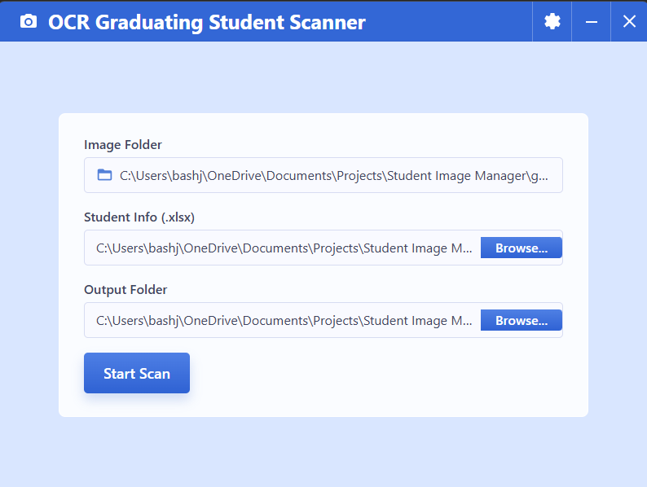
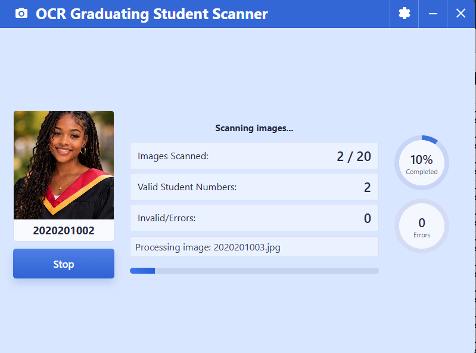
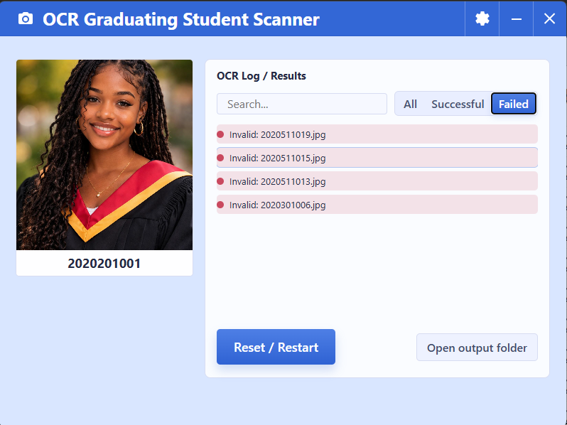
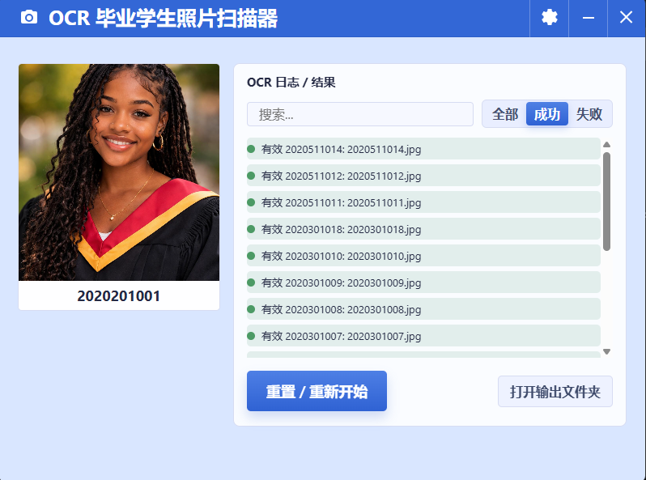

# Student Image Organizer

**Turning a two-to-three-day photo sorting task into a process that takes under two hours.**

Student Image Organizer is a Windows desktop app that reads student ID numbers from photos, matches them with an Excel student list, renames the files, and organizes them by department.

## The problem

I built the original version in April 2021 while working in the Student Admin Affairs Office. Preparing student photos for distribution meant opening each image, reading its printed ID number, finding the matching student in a spreadsheet, renaming the file, and placing it in the correct department folder. Repeating that process for a large batch took two to three days and left room for identification and filing errors.

I designed the app to handle that workflow from start to finish, while keeping failed matches visible for review.

## Impact

| Before | With the original workflow |
| --- | --- |
| Two to three days of manual sorting | Under two hours per batch |
| Repeated manual ID lookups and file renaming | OCR, spreadsheet matching, and automatic naming |
| Files sorted by hand | Department folders created automatically |

The original workflow reduced processing time by approximately **90%** and improved student identification accuracy to **nearly 100%**, addressing mistakes common in manual processing. These are results from the administrative work that inspired this portfolio project.

## What the app does

1. **Reads the ID:** OpenCV and Pillow prepare each image; Tesseract OCR extracts the printed student number.
2. **Checks the result:** Configurable regular expressions validate the extracted number.
3. **Finds the student:** Pandas and OpenPyXL match the ID against an Excel file and retrieve the student's details.
4. **Organizes the photos:** The app renames each image using the student number, name, department, and passport number, then copies or moves it into a department folder.
5. **Shows what needs attention:** Live progress and logs show the scan results. Failed images are collected in an `errors` folder and recorded in `errors.json`.

For example, a matched image can be written to:

```text
output/
└── IT/
    └── 2020201234_Lovelace_Ada_IT_P123.jpg
```

The interface lets users choose the image folder, spreadsheet, and output location; adjust ID patterns and department rules; preview images; and review results. Photos and spreadsheet data are processed locally.

## Built with

**Python · pywebview · HTML/CSS/JavaScript · Tesseract OCR · OpenCV · Pillow · Pandas · OpenPyXL · PyInstaller**

The UI runs in pywebview. A Python worker handles batch processing so the interface can show progress while images are scanned. Settings are stored as JSON under the Windows user profile.

## Screenshots

**Choose inputs and an output folder**



**Follow a scan in progress**



**Review images that need attention**



The interface also supports Simplified Chinese:



## Run locally

Use Python 3.11 or newer on Windows. From the project directory:

```powershell
py -m venv .venv
.\.venv\Scripts\python.exe -m pip install -r requirements.txt
.\.venv\Scripts\python.exe -m app.main
```

Select a folder of JPG, JPEG, PNG, TIFF, or BMP images and an Excel file with `student_no`, `first_name`, `last_name`, and `passport_number` columns. The column names and ID rules can be changed in settings. The project includes an English Tesseract executable and OCR data in `app/Tesseract-OCR/`.

## Build for Windows

```powershell
.\.venv\Scripts\python.exe -m pip install -r requirements-build.txt
.\.venv\Scripts\python.exe -m PyInstaller --noconfirm student_image_organizer.spec
```

The packaged app is created in `dist/VANTIX Student Image Organizer/`. The build includes the UI, icon, default configuration, Tesseract executable, and English OCR data. The bundled Tesseract is a legacy build that may require the Visual C++ 2008 runtime on a target PC.

User settings are saved to `%APPDATA%\VANTIX Student Image Organizer\config.json`; the bundled defaults remain unchanged.
